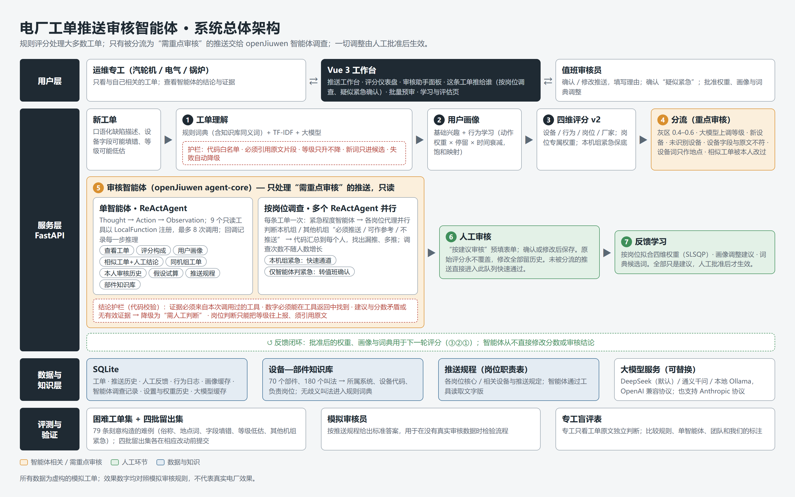
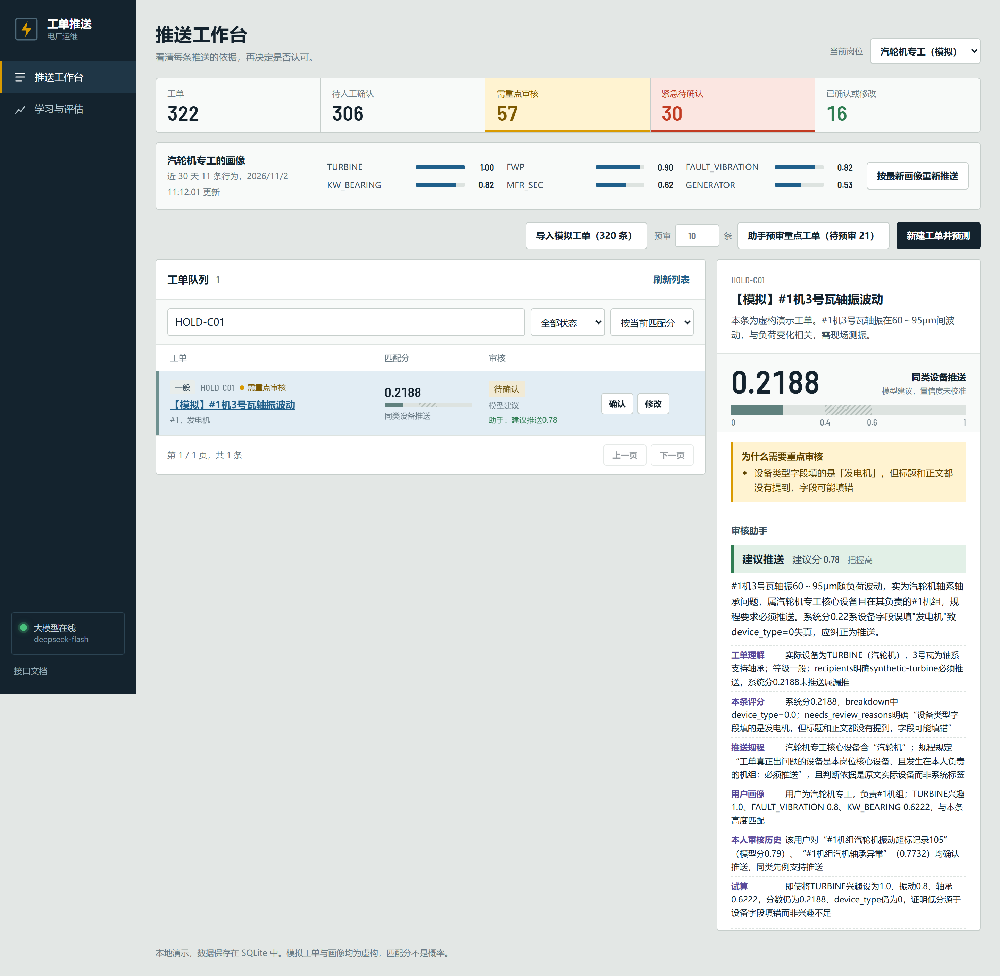

# 电厂工单推送审核智能体（PowerOps Review Agent）

> openJiuwen 智能体创新大赛参赛作品 · 方向：办公（流程自动化）/ 设备互联
> 许可证：Apache-2.0 · 所有演示数据均为模拟数据

火电厂每天产生大量设备缺陷工单，系统要决定“这条工单该推给哪位专工”。本作品在规则推荐模型之上，加入大模型工单理解和一个基于 **openJiuwen ReActAgent** 的审核智能体：对分数模棱两可的推送，智能体自己决定查什么（工单、评分构成、用户画像、相似历史工单与当时的人工结论、同机组近况、本人审核习惯、假设试算、推送规程、设备—部件知识库），给出“推送 / 不推送 / 需人工判断”的建议和可追溯的证据；还可以用 **openJiuwen 多智能体团队**（工单理解 → 调查 → 复核）复核结论，并反向判断这条工单还应推给谁；人工确认或修改后，系统再从反馈中学习权重和画像，但每项调整都要人批准才生效。





## 应用场景

- **用户**：电厂运维专工（汽轮机、电气、锅炉等）与值班审核人员。
- **痛点**：工单量大、描述不规范；按设备类型粗推，专工被无关工单淹没，关键缺陷又可能漏推；人工逐条审核推送结果耗时，审核依据也不留痕。
- **作品做什么**：大模型把非结构化工单转成受约束的标签；评分模型给出个性化推送分；审核智能体只处理“需重点审核”的那一部分，像值班工程师一样调查并留下证据链；人的每次确认/修改都变成可审计的学习信号。

## 技术架构

```text
新工单 ─► ① 工单理解：规则 + TF-IDF + 大模型（词表白名单 / 原文引用校验 / 等级只升不降）
       ─► ② 用户画像：手工基础兴趣 + 行为学习（时间衰减 + 饱和函数）
       ─► ③ 四维加权评分 v2（设备 / 行为 / 岗位 / 厂家，紧急保底，岗位专属权重）
       ─► ④ 相似历史工单 + 重点审核分流（含文本检查：未识别设备、字段与原文不符、设备词只作地点）
       ─► ⑤ 审核智能体（openJiuwen ReActAgent）
              Thought → Action（9 个只读工具，LocalFunction 注册）→ Observation，最多 8 次工具调用
              或多智能体团队（openJiuwen HandoffTeam）：理解 → 调查 → 复核（可退回一次），附漏推 / 多推提示
              └► submit_conclusion ─► 结论护栏：证据须来自本次调用的工具、数字须可在返回中找到、矛盾即降级
       ─► ⑥ 人工确认 / 修改 ─► 反馈学习（权重拟合、画像建议、词典扩充），人工批准后生效
存储：SQLite（工单、推送历史、反馈、行为、画像、智能体调查记录）  界面：Vue 3 工作台
知识：推送规程（core/policy.py）、设备—部件知识库（70 个部件、180 个叫法）
```

详细说明见 [系统架构说明](docs/competition/ARCHITECTURE.md)。

审核智能体（单条推送的调查）有三个可互换的引擎，接口、存储和界面完全相同：

| 引擎 | 文件 | 说明 |
|---|---|---|
| openJiuwen（默认） | `core/agent_openjiuwen.py` | openJiuwen agent-core `ReActAgent` 驱动推理-行动循环；工具以 `LocalFunction` 注册到 `ability_manager`；`AFTER_MODEL_CALL` 回调记录推理过程。需 Python 3.11–3.13 |
| openJiuwen 多智能体团队 | `core/agent_team.py` | openJiuwen `HandoffTeam` 编排工单理解员、调查员、复核员三个 ReActAgent，用 `transfer_to` 交接；结论由代码汇总校验；另给出可能漏推 / 多推的专工 |
| 内置 | `core/agent.py` | 自写的工具调用循环，用于没有安装 openjiuwen 的环境（如 Python 3.14） |

由环境变量 `AGENT_ENGINE=openjiuwen|openjiuwen_team|builtin` 选择，未设置时装了 openjiuwen 就用它。`GET /llm/status` 返回当前引擎。

## 功能详解

- **模型工程化**：独立 `PushPredictor`，复用规则与 TF-IDF 提取、四维匹配评分，提供结构化接口、输入校验和推送理由。
- **全栈开发**：Vue 3 + Vite、FastAPI + Swagger、SQLite，实现工单导入、新建预测、查询排序和持久保存。
- **行为驱动画像**：查看详情、查询、下载、点赞等行为写入 SQLite，按原论文公式（动作权重 × 停留时长 × e^(-λΔt)）累加，再用饱和函数换算为兴趣（少量点击不会把兴趣拉满）；模拟岗位的手工兴趣作为基础值，行为只会在其上提高兴趣。
- **大模型工单理解（可选）**：在规则 + TF-IDF 之外调用大模型提取标签并复核工单等级。输出受约束：标签代码必须在现有词表里，每条结论必须引用原文片段，等级只能上调不能下调；词表外的新词只进入“待确认”列表，不参与评分。未配置或调用失败时自动退回规则提取，结果按工单内容缓存在 SQLite。
- **相似历史工单**：本地按“文本字符 n-gram TF-IDF × 0.7 + 标签重合度 × 0.3”检索相似工单，不调用外部接口；详情里列出相似工单及它们当时被人工确认还是修改、修改理由是什么。
- **AI 推送解读**：在详情面板点击“生成 AI 解读”，大模型根据评分明细、用户画像和相似工单写一段说明。它不改变分数，引用的相似工单必须是真实存在的，结果缓存。
- **重点审核分流**：分数落在 0.4–0.6 灰区、大模型上调了等级、大模型识别出规则没覆盖的设备、大模型调用失败、本人曾修改过相似工单且修正分与本条分数相差超过 0.15、未识别出设备、设备类型字段在原文中没有出现、设备词只出现在地点描述中（如汽机房、主变区域），满足任一条件的推送会标为“需重点审核”并写明原因，其余可以快速过一遍。
- **反馈学习（学习与评估页）**：用人工审核结果计算模型与人工的一致程度；反推一组更贴近人工判断的四维权重；把反复出现的人工修改转成画像调整建议（附依据，启用大模型时附 AI 复盘）；审核大模型发现的新词并加入词典。所有调整都只是建议，审核人批准后才生效，权重修改留有历史记录。
- **审核助手 Agent（openJiuwen ReActAgent）**：对“需重点审核”的推送，大模型自主决定调查步骤，从 9 个只读工具中选用：工单、评分构成、用户画像、相似工单及人工结论、同机组工单、本人审核历史、假设试算、推送规程、设备—部件知识库。最多 8 步，最后给出“建议推送 / 不推送 / 需人工判断”、建议分和证据。每条证据必须来自本次实际调用过的工具，证据里的数字必须能在本次调查的工具返回中找到（允许四舍五入），否则标为“未核实”；没有有效证据或结论自相矛盾时降级为“需人工判断”。完整调查过程留档，Agent 不修改任何分数，“按建议审核”只是预填表单，仍需人工保存。
- **这条工单推给谁（按岗位调查）**：一条工单只调查一次。推送等级取大模型等级复核；紧急程度智能体同时判断，它独自判为紧急时标为“疑似紧急”交值班人员确认。每个岗位一个 openJiuwen ReActAgent 并行判断本机组 / 其他机组的本岗位人员“必须推送 / 可作参考 / 不推送”，代码展开到每个人，提示可能漏推、多推；等级为紧急时按规程立即推送本机组各专业。调查次数不随员工人数增长，每条工单约 12 秒。
- **串行团队（openJiuwen HandoffTeam，保留作对照）**：理解员不看评分只读原文，判断实际设备（须引用原文）、实际等级和应接收人；调查员在此基础上调查；复核员专门质疑调查结论，可退回一次；复核最终仍有异议时降级为“需人工判断”。理解员给出的应接收人与系统当前推送对比，提示可能漏推、可能多推的专工。
- **设备—部件知识库**：70 个部件、180 个叫法，对应所属系统、设备代码和负责岗位（通用专业常识）。无歧义的叫法启动时加入规则词典，有歧义的只供智能体查询和分流提示。
- **困难工单评测与专工盲评**：47 条刻意构造的难例（主集 + 两批留出集，留出集在相应改动前提交），分批比较规则、单智能体和团队；专工盲评表只给专工看工单原文，用来检验系统和我们自己的标注。
- **评分公式 v2**：负责机组的工单只有设备对口或紧急时才拿满岗位分，避免同机组无关工单带固定底分；每个岗位可以有自己的四维权重。
- **批量重新推送**：原每日 07:00 定时任务改为 `POST /push/run` 手动触发，用最新画像对全部工单重新评分，结果没变的不新增历史。
- **人机协同**：人工确认/修改后刷新可读，原模型结果及每次反馈保留；新预测重新进入待审核状态。

**效果口径**：文档中出现的一致率、平均误差等数字，参照的都是 `scripts/simulate_review.py` 的规则审核结论，数据都是模拟工单，只能说明流程和约束按设计工作，不代表真实电厂效果（见 [数据来源说明](docs/competition/DATA_STATEMENT.md)）。评分是规则与画像驱动的匹配分，未提供监督训练权重。匹配分不是正确概率；`confidence` 返回 null，界面显示“未校准”。模拟画像权重是演示输入。人工反馈不自动训练模型，不展示准确率/召回率。

## 部署与快速上手（Windows）

依赖清单见 `requirements-openjiuwen.txt`（openJiuwen 引擎）、`requirements-demo.txt`（内置引擎）、`frontend-vue/package.json`，许可证见 [THIRD_PARTY_NOTICES.md](THIRD_PARTY_NOTICES.md)。需要 Python 3.12（openjiuwen 支持 3.11–3.13）和 Node.js 20.19+。

1. **安装后端**：双击 `setup_openjiuwen.bat`，它用 `py -3.12` 创建 `.jiuwen-venv` 并安装 openjiuwen 与其他依赖，最后自检。（只有 Python 3.14 时可改用 `setup_venv.bat`，审核助手会使用内置引擎。）
2. **构建前端**：`cd frontend-vue && npm ci && npm run build`。
3. **配置大模型**：复制 `llm.env.example.bat` 为 `llm.env.bat`，取消 DeepSeek 一段的注释并填入自己的 Key。`llm.env.bat` 已被 git 忽略，不要分享。不配置也能运行，此时只用规则 + TF-IDF，审核助手不可用。
4. **启动**：双击 `start_demo.bat`，窗口会显示所用引擎；浏览器打开 http://127.0.0.1:8000，Swagger 在 `/docs`。

手动启动：

```powershell
py -3.12 -m venv .jiuwen-venv
.\.jiuwen-venv\Scripts\python.exe -m pip install -r requirements-openjiuwen.txt
.\.jiuwen-venv\Scripts\python.exe -m uvicorn demo_api:app --host 127.0.0.1 --port 8000
```

SQLite 自动创建于 `data/demo.sqlite3`，重启保留；`DEMO_DB_PATH` 可指定其他数据库文件。开发前端时保持后端运行，在 `frontend-vue` 执行 `npm run dev`（http://127.0.0.1:5173，代理到后端，可用 `DEMO_API_TARGET` 修改）。

## 接入大模型（可选）

按上面第 3 步配置 `llm.env.bat` 后重启 `start_demo.bat` 即可（模型 `deepseek-flash`，已关闭思考模式；`deepseek-chat` 已于 2026-07-24 下线）。换其他服务商可参考 `llm.env.example.bat`。支持任何 OpenAI 兼容接口（DeepSeek、通义千问、本地 Ollama 等）和 Anthropic Claude。启动后左下角显示“大模型：模型名”即为启用。

- 每条工单只调用一次，结果按“提示词版本 + 模型 + 工单原文 + 等级”缓存；更换模型或修改工单内容才会重新调用。
- 导入 320 条模拟工单时会产生 320 次调用（4 条并发），请留意费用；本地 Ollama 不产生费用。
- `GET /llm/status` 查看是否启用，`GET /terms/candidates` 查看大模型发现的词表外新词。

## 三分钟演示

0. 左下角显示“大模型：deepseek-flash”，启动窗口显示 “Review agent engine: openJiuwen ReActAgent”。

1. 选择“汽轮机专工”，点击“导入模拟工单（320 条）”；计算真实程序输出，重复点击跳过当前岗位已有的模拟工单。
2. 按匹配分排序，搜索工单、筛选审核状态，点击标题查看四维评分、提取标签和推送理由。
3. 点击“确认”；再点击“修改”，填写修正分数/类型及理由。刷新页面核对保存结果和反馈历史。
4. 多点几条工单查看详情，画像栏会出现新学到的兴趣；点击“按最新画像重新推送”，结果变化的工单重新进入待确认。
5. 筛选“需重点审核”，在详情里点击“让审核助手调查”，查看它一步步调用了哪些工具、给出的建议和证据；也可以用“批量预审”一次处理多条。用 `AGENT_ENGINE=openjiuwen_team` 启动时，还会看到复核意见、工单理解和可能漏推 / 多推的专工。
6. 点击“新建工单并预测”，输入设备与异常原文。也可切换另一模拟岗位并导入同批工单，对比推荐差异。

## 目录与接口

| 路径 | 内容 |
|---|---|
| `core/inference.py`、`core/matching.py`、`core/nlp.py` | 推理、评分、标签提取 |
| `core/llm.py` | 大模型工单理解：服务商适配、词表/原文约束校验、等级复核、缓存与降级 |
| `core/similar.py` | 相似历史工单检索 |
| `core/learning.py` | 权重拟合、画像调整建议、一致性指标 |
| `core/agent_openjiuwen.py` | 审核智能体：openJiuwen ReActAgent 引擎 |
| `core/agent.py` | 审核工具集、结论护栏、内置引擎 |
| `core/agent_dispatch.py`、`core/agent_urgency.py` | 按岗位调查、紧急程度智能体 |
| `core/agent_team.py` | 串行团队（openJiuwen HandoffTeam，作对照） |
| `scripts/scale_test.py` | 员工规模测试 |
| `core/policy.py`、`core/knowledge.py`、`data/knowledge/` | 推送规程、设备—部件知识库 |
| `scripts/eval_hard_cases.py`、`data/synthetic/hard_cases*.json`、`data/eval/` | 困难工单评测与结果 |
| `scripts/make_blind_review.py`、`scripts/score_blind_review.py`、`data/blind_review/` | 专工盲评表、答案键与计分 |
| `scripts/simulate_review.py` | 按岗位规则模拟审核（`--undo` 撤销） |
| `docs/competition/` | 参赛材料：需求与场景、系统架构、落地可行性、创意亮点、界面示意、数据来源、既有基础与新增贡献、参考文档、开发日志 |
| `docs/diagrams/`、`frontend-vue/render-docs.mjs` | 架构图源文件；生成架构图 PNG 与文档 PDF |
| `scripts/evaluate.py` | 命令行输出一致性指标与权重拟合结果：`python scripts/evaluate.py [数据库路径]` |
| `core/profile_builder.py` | 行为 → 画像构建（原 PostgreSQL 版 ProfileBuilder 的无数据库移植） |
| `demo_api.py`、`core/sqlite_store.py` | API 与 SQLite 表（工单、预测、反馈、用户、行为、画像） |
| `frontend-vue/` | Vue 管理工作台 |
| `data/synthetic/`、`scripts/generate_demo_data.py` | 可复现模拟数据与生成器 |
| `tests/`、`frontend-vue/tests/` | 后端功能与浏览器流程测试 |

`POST /predict` 返回推送结果，可传显式 `profile` 或只传 `user_id`（使用该用户的行为画像）；`POST /behaviors` 上报行为；`GET /users/{id}/profile` 读取画像；`POST /push/run` 批量重新推送；`GET /orders` 返回工单、历史与当前人工审核结果；`POST /predictions/{id}/feedback` 保存确认/修正。前端通过同源 `/api` 别名访问。详见 [API](docs/api.md)、[推理](docs/inference.md)、[SQLite](docs/sqlite.md)、[模拟数据](data/synthetic/README.md)。

## 验证

```powershell
# 在 .jiuwen-venv 中运行全部测试（含 openJiuwen 引擎测试；在没有 openjiuwen 的环境中这 2 项自动跳过）
.\.jiuwen-venv\Scripts\python.exe -W ignore -m unittest discover -s tests -v
cd frontend-vue
npm run build
npx playwright install chromium
npm run test:e2e
```

浏览器测试在 8766 端口使用独立临时数据库，覆盖导入、确认、修改、刷新读取、新建预测、连接异常恢复和移动端布局。测试验证功能，不代表模型效果指标。

原 React 前端、PostgreSQL 后端（`main.py`、`modules/`、`tasks.py`、Docker 配置等）已归档到 `_legacy/`，不再维护，说明见 [_legacy/README.md](_legacy/README.md)。本页的 Vue / SQLite 版本是唯一主线。该版本面向本地单人演示，审核人手工填写，未实现登录权限控制。

## 许可证与声明

- 本作品以 [Apache License 2.0](LICENSE) 开源，版权声明见 [NOTICE](NOTICE)。
- 第三方依赖与许可证：[THIRD_PARTY_NOTICES.md](THIRD_PARTY_NOTICES.md)。
- 既有基础与本次新增贡献：[docs/competition/BASELINE_AND_CONTRIBUTIONS.md](docs/competition/BASELINE_AND_CONTRIBUTIONS.md)；开发日志：[docs/competition/DEVLOG.md](docs/competition/DEVLOG.md)。
- 数据全部为模拟生成，说明见 [docs/competition/DATA_STATEMENT.md](docs/competition/DATA_STATEMENT.md)。
