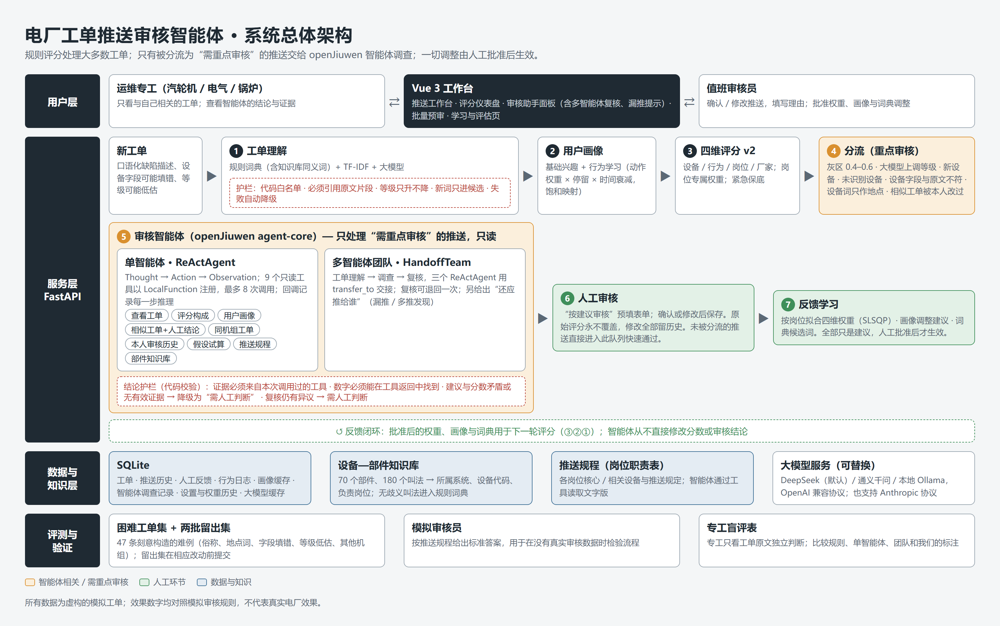
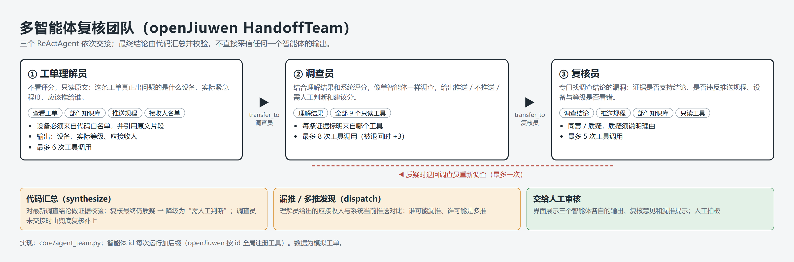

# 系统架构说明

作品：电厂工单推送审核智能体（田贵恒，个人参赛）

## 一、总体架构

设计原则：**规则打底，智能体只处理难例，人来拍板。**

1. 每条新工单先经过受约束的工单理解和四维评分，得到每位专工的推送分数；
2. 分流模块找出“拿不准”的推送，说明原因；其余推送直接进入人工审核队列，快速通过；
3. 只有被分流的推送交给 openJiuwen 审核智能体调查。智能体只能调用只读工具，结论经过代码校验；
4. 人工确认或修改推送；审核结果用于拟合权重、提出画像和词典调整建议，人工批准后才生效。

## 二、模块说明

| 模块 | 位置 | 作用 | 关键约束 |
|---|---|---|---|
| 工单理解 | `core/nlp.py`、`core/llm.py` | 规则词典 + TF-IDF + 大模型，提取设备、故障、关键词、厂家标签，复核等级 | 标签代码必须在白名单内；每个标签必须引用原文片段；等级只升不降；词表外新词只进入候选，不参与评分；大模型失败自动退回规则结果；结果按提示词版本缓存 |
| 设备—部件知识库 | `data/knowledge/components.json`、`core/knowledge.py` | 70 个部件、180 个叫法 → 所属系统、设备代码、负责岗位 | 无歧义叫法在启动时加入规则词典；有歧义的只供智能体查询和分流提示 |
| 用户画像 | `core/profile_builder.py` | 基础兴趣 + 行为学习（动作权重 × 停留时长 × e^(−0.05·天数)，1 − e^(−w/8) 饱和映射） | 纯函数；画像缓存 1 小时，有新行为即失效 |
| 四维评分 v2 | `core/matching.py` | 设备、行为、岗位、厂家四维加权；紧急事件保底 0.75 | 负责机组但设备无关只给岗位分 0.3；分数是匹配分，不是概率 |
| 分流 | `core/inference.py` | 标出需重点审核的推送并给出原因 | 灰区 0.4–0.6、大模型上调等级、新设备、未识别设备、设备字段与原文不符、设备词只作地点、相似工单曾被本人修改 |
| 相似工单 | `core/similar.py` | 字符 n-gram TF-IDF × 0.7 + 标签 Jaccard × 0.3，附当时的人工结论 | 工单变化时重建索引 |
| 推送规程 | `core/policy.py` | 各岗位核心 / 相关设备与推送规定 | 智能体只能读到定性文字版，读不到目标分数 |
| 审核智能体（单） | `core/agent_openjiuwen.py`、`core/agent.py` | openJiuwen ReActAgent 自主调查，给出推送建议、建议分、证据 | 9 个只读工具；最多 8 次调用；结论护栏见第四节 |
| 多智能体团队 | `core/agent_team.py` | openJiuwen HandoffTeam：理解 → 调查 → 复核；漏推 / 多推发现 | 见图 2 |
| 反馈学习 | `core/learning.py` | 按岗位拟合四维权重（SLSQP，权重和为 1）、画像建议、一致性指标 | 只产生建议；批准接口是唯一生效途径 |
| 存储 | `core/sqlite_store.py` | 工单、推送历史、反馈、行为、画像、智能体调查记录、设置历史、大模型缓存 | 推送结果只追加；人工修改不覆盖模型输出 |
| 接口 | `demo_api.py` | FastAPI，全部业务接口与输入输出校验 | 同时挂在 `/` 与 `/api` |
| 界面 | `frontend-vue/` | Vue 3 推送工作台、审核助手面板、学习与评估页 | 控制室风格；数字字体本地打包，不依赖境外字体服务 |

## 三、审核智能体

### 单智能体（openJiuwen ReActAgent）

- 循环：Thought（模型决定下一步查什么）→ Action（调用一个工具）→ Observation（读取工具返回），由模型自己规划调查路线；
- 工具：以 openJiuwen `LocalFunction` 注册，通过 `ability_manager.add_ability` 挂到智能体上；

  | 工具 | 返回内容 |
  |---|---|
  | get_order | 工单原文、等级、机组、提取的标签、大模型等级复核 |
  | get_prediction | 本条推送分数、四维明细、所用权重、规则理由、重点审核原因 |
  | get_user_profile | 岗位、负责机组、各类兴趣、近 30 天行为数 |
  | search_similar | 相似历史工单、相似度、当时的人工结论和理由 |
  | recent_unit_orders | 同机组近期工单（可按设备过滤） |
  | user_review_history | 本人对含某标签工单的审核历史 |
  | what_if | 假设试算：改等级、兴趣或权重后的分数（只算不存） |
  | get_push_policy | 推送规程文字版 |
  | lookup_component | 设备—部件知识库查询 |
  | submit_conclusion | 提交结论（不计入调用次数） |

- 推理过程通过 `AFTER_MODEL_CALL` 回调逐步记录，界面可展开查看；
- openJiuwen 的协程统一在一个长期运行的后台事件循环中执行（修复了连续调用时“Event loop is closed”的问题）。

### 多智能体团队（openJiuwen HandoffTeam）

- 三个 ReActAgent 通过 openJiuwen 注入的 `transfer_to_<id>` 工具交接；
- 理解员不看评分，只读原文，给出实际设备、实际等级和应接收人；
- 调查员在理解结果的基础上调查；复核员专门质疑，可退回一次；
- 最终结果由代码汇总（`synthesize`），而不是直接采信某个智能体的输出；
- 智能体 id 每次运行加后缀，因为 openJiuwen 按 id 全局注册工具。

### 引擎切换

`AGENT_ENGINE=openjiuwen_team | openjiuwen | builtin`。未安装 openJiuwen 时退回内置的工具调用循环；三种引擎共用同一套工具、护栏、存储和界面，返回相同格式。

## 四、结论护栏（代码校验）

智能体提交结论后，由 `validate_conclusion` 校验：

1. 每条证据必须标明来自哪个工具，且该工具本次确实被调用过，否则丢弃；
2. 证据中的数字必须能在该工具的返回中找到（允许四舍五入），否则标为“未核实”；
3. 推送建议与建议分矛盾（例如“建议推送”但建议分低于阈值）→ 降级为“需人工判断”；
4. 没有有效证据 → “需人工判断”；
5. 团队模式下，复核员最终仍有异议 → “需人工判断”。

智能体全部工具只读，不能修改分数、标签或审核结论。

## 五、数据流

1. 工单导入（`POST /predict` 或批量导入）→ 工单理解 → 对每位用户评分 → 写入推送历史，状态为“待确认”；
2. 分流结果随推送一起返回（`triage`）；
3. 用户在界面点“让审核助手调查”或“助手预审重点工单” → `POST /predictions/{id}/agent-review` → 智能体调查 → 记录写入 `agent_runs`；
4. 审核员确认 / 修改 → 写入反馈（只追加）；
5. “学习与评估”页读取反馈，生成建议；批准接口（权重、画像、词典）是唯一的生效途径；
6. `POST /push/run` 按最新画像和权重重新评分全部工单，结果未变化的不重复写入。

## 六、技术栈

| 层 | 技术 | 用途 |
|---|---|---|
| 智能体框架 | openJiuwen agent-core 0.1.19（ReActAgent、LocalFunction、回调、HandoffTeam） | 单智能体调查与多智能体团队 |
| 大模型 | DeepSeek API（deepseek-flash，默认）；可换通义千问、本地 Ollama 等 OpenAI 兼容服务，也支持 Anthropic 协议 | 工单理解、智能体推理 |
| 后端 | Python 3.13、FastAPI、Pydantic、httpx | 接口、校验、模型调用 |
| 文本与学习 | jieba、scikit-learn（TF-IDF）、SciPy（SLSQP） | 标签提取、相似检索、权重拟合 |
| 存储 | SQLite | 单文件数据库，演示与小规模部署 |
| 前端 | Vue 3、Vite | 工作台界面 |
| 测试 | unittest（60 个后端用例，含用本地假模型驱动 openJiuwen 的端到端测试）、Playwright | 回归与界面测试 |
| 评测 | `scripts/eval_hard_cases.py`、`scripts/make_blind_review.py`、`scripts/score_blind_review.py` | 困难工单评测、专工盲评 |
