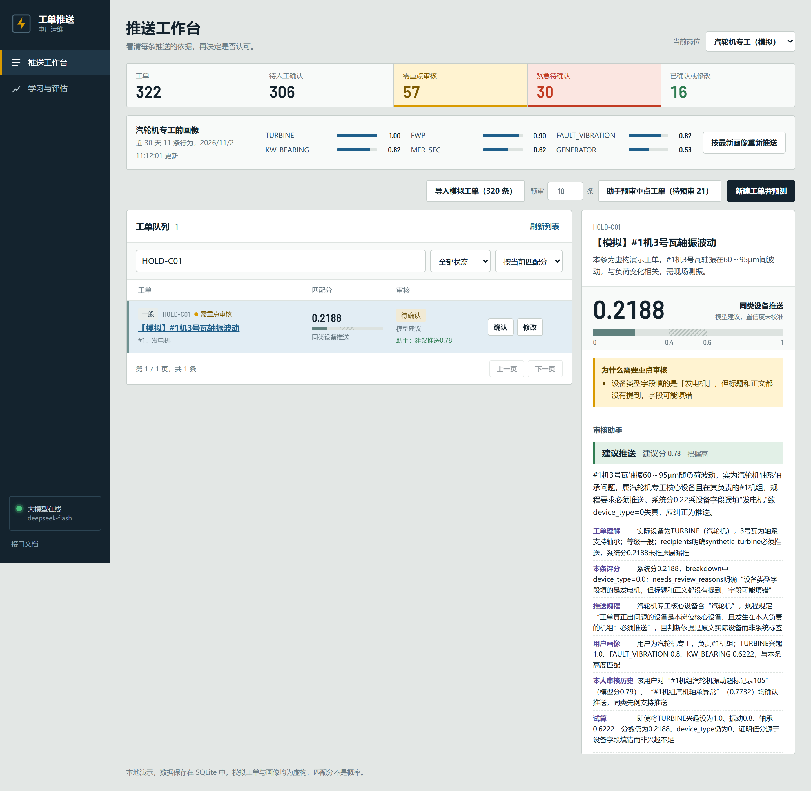
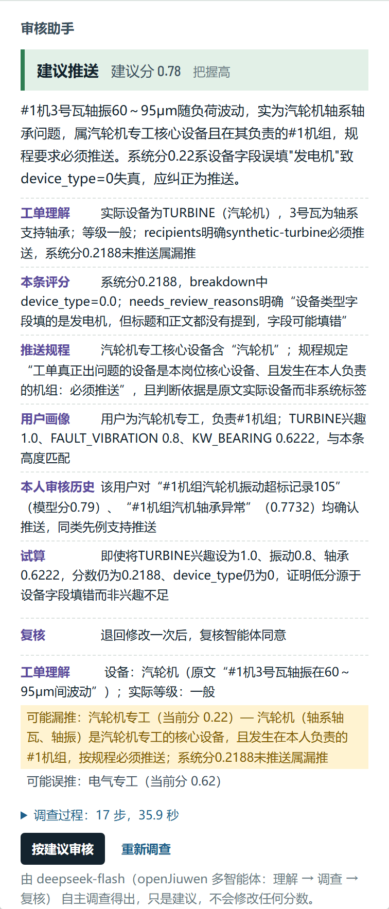
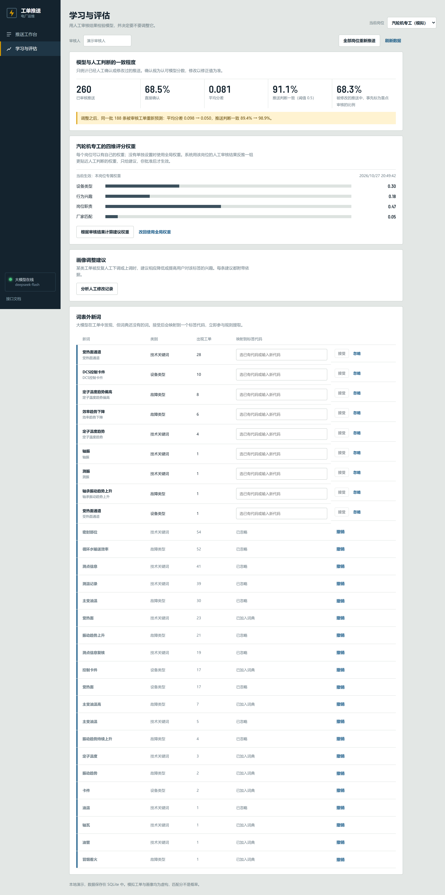
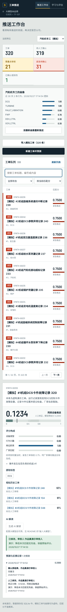

# 界面原型与示意

作品：电厂工单推送审核智能体（田贵恒，个人参赛）

以下均为**可运行原型的实际截图**，不是设计稿。数据为模拟工单和虚构岗位。截图于 2026-11-02 在演示数据库的临时副本上拍摄；多智能体团队的调查由 DeepSeek（deepseek-flash）经 openJiuwen 实际运行得出。

## 一、推送工作台（汽轮机专工视角）

从上到下：

1. **概览**：工单总数、待人工确认、需重点审核、紧急待确认、已确认或修改；
2. **当前用户画像**：从行为中学习到的兴趣（设备、故障、关键词、厂家），可按最新画像重新推送；
3. **操作栏**：导入模拟工单、助手批量预审重点工单（可设条数）、新建工单并预测；
4. **工单队列（左）**：每条显示等级、编号、“需重点审核”标记、匹配分、推送类型、审核状态和助手建议；可搜索、按状态筛选、排序；
5. **推送详情（右）**：
   - 工单原文；
   - **评分仪表**：0–1 匹配分，0.4–0.6 灰区用斜线标出，是界面的标志元素；
   - **为什么需要重点审核**：分流原因，本例为“设备类型字段填的是发电机，但标题和正文都没有提到，字段可能填错”；
   - **审核助手**：智能体的结论与证据（见下图）。

## 二、审核助手面板（多智能体团队）

本例是虚构工单“#1机3号瓦轴振波动”，设备类型字段误填为“发电机”。规则给汽轮机专工打 0.22 分，不会推送。

- **结论行**：建议推送，建议分 0.78，把握高；
- **摘要**：用一段话说明判断理由；
- **逐条证据**：每条前面标明来自哪个工具，如工单理解、本条评分、推送规程、用户画像、本人审核历史、试算；数字在工具返回中找不到的，会标“未核实”；
- **复核**：本例中复核智能体第一次提出质疑，调查员修改后复核同意；
- **工单理解**：理解员给出的实际设备（附原文片段）和实际等级；
- **可能漏推 / 可能误推**：本例提示汽轮机专工可能漏推，电气专工（当前分 0.62）可能误推；
- **调查过程**：可展开查看每一步的推理和工具调用，本例 17 步、35.9 秒；
- **按建议审核**：把智能体的建议预填进审核表单，由人确认或修改后保存；**重新调查**；
- 底部说明：“只是建议，不会修改任何分数”。

## 三、学习与评估

- **模型与人工判断的一致程度**：已审核推送数、直接确认比例、平均分差、推送判断一致率、被修改的推送中事先被标为重点审核的比例；以及调整前后的对比。演示中的审核结论来自模拟审核员；
- **岗位四维权重**：当前生效的权重；根据审核结果计算建议权重，批准后才生效，可改回全局权重；
- **画像调整建议**：分析人工修改记录，建议调高或调低某类兴趣，每条附依据；
- **词表外新词**：大模型发现、词典里还没有的词，审核员选择映射到哪个标签代码后接受，或忽略；接受后立即参与规则提取。

## 四、关键用户路径

1. 打开工作台，按“需重点审核”筛选；
2. 点开一条推送，看分流原因和评分构成；
3. 点“让审核助手调查”，或在操作栏批量预审；
4. 阅读结论、证据、复核意见和漏推提示；
5. 点“按建议审核”，确认或修改后保存，修改须填写理由；
6. 定期在“学习与评估”页批准权重、画像和词典调整。

## 五、移动端

界面为响应式布局，手机宽度下无横向滚动（Playwright 自动化测试中检查）。

